# Lab 09: Ray Tracing and Path Tracing

**Thanakrit Weeraphatiwat - Student ID 6731323721**
CP479 Computer Graphics - 6 November 2026

## 1. Machine and reproducibility

| Item | Configuration |
| --- | --- |
| CPU / threads | Intel Core Ultra 9 275HX; 24 physical cores, 24 logical threads; 24 render threads |
| OS | Windows 11 Home Single Language, 10.0.26200 |
| Compiler / build | MSVC 19.51.36257.0, x64; C++17; Release |
| CMake / generator | 4.3.1-msvc1 / Visual Studio 18 2026 |
| Build command | `cmake --build build --config Release` |
| Ray / mesh defaults | 800 x 600, vertical FOV 60 degrees, depth 4, EPS 0.001 |
| Path defaults | 256 x 256, 16 spp, depth 64, seed 0, NEE and roulette enabled |
| Timing | Internal render wall time, excluding image saving; three sequential mesh sweeps summarized by their medians; other timings are single runs |

The recorded experiments were run on 5 November 2026. Their source revision, B1, is identified by the [manifest and source snapshots](../../evidence/data/session-manifest.json), based on commit `3d3361d99d412349f20362b4cd324ca9cb407072`. The current three student files differ from B1 only in comments and whitespace. All measurements below are actual runs unless labelled as estimates. Short timings can vary with scheduling, power state and background work.

## 2. Student predictions: later learning exercise

These are the student's original responses, preserved verbatim and recorded on 6 November 2026 (Asia/Bangkok). They were supplied after the 5 November measurements and with AI hints; they are not represented as predictions recorded before measurement. Technical clarifications are separate from the student's words.

### Prediction for 2.1: triangle-count scaling

> “With brute force, I expect render time and triangle tests per ray to increase linearly/multiplicatively? O(mn)? as triangle count increases, because every ray has to check more triangles.”

> “With a BVH, I expect the increase to be increase a bit less aggressive (may be log or something or even grow slower than that like some small term) because a ray can skip all the boxes it doesn't hit and only calculate the triangles that inside the boxes it crosses?.”

> “I expect SAH to cost more to build, but it might be faster? during rendering. I’m uncertain which wins because the overhead might outweighted in some scenarios?.”

**Technical clarification, 6 November 2026.** With P rays and N triangles, brute-force intersection work is O(PN), or O(N) per ray reaching the mesh. With fixed resolution and ray workload, increasing N therefore gives roughly linear work. BVH traversal can reject entire groups; well-behaved cases often grow approximately logarithmically, but this is not a worst-case guarantee. SAH spends more time building a tree and can reduce triangle work without necessarily minimizing wall time.

### Prediction for 3.1: samples and noise

> “As spp increases, I expect RMSE to drop asymtoically/logarithmic and slower as it goes and runtime to increase linearly. My reasoning is (have no idea about this) like it use more samples so the variance drop statistically or like don't have to guess much?. Changing the seed should change (also have no idea about this)noise pattern while keeping approximately the same amount of noise.”

**Technical clarification, 6 November 2026.** For independent samples with finite variance, variance of the average falls as 1/N and its standard deviation falls as 1/sqrt(N). The expected log-log noise slope is -0.5, rather than logarithmic decay. Runtime is approximately proportional to spp. RMSE times sqrt(spp) is approximately constant while image sampling noise dominates; the noisy reference and correlation can change this at high spp. Ten times less sampling noise than at 16 spp requires approximately 1600 spp. A different seed changes the noise pattern while preserving its expected distribution.

### Prediction for 3.2: explicit lamp sampling

> “At 16 spp, I expect disabling NEE to make the image more noisy/speckles because random bounce directions rarely hit the light sources. It may take less time per sample because it doesn't shoot shadow rays, but matching NEE’s error should require higher sample count (I don't know which one would be more efficient in quality/runtime).”

**Technical clarification, 6 November 2026.** NEE adds visibility queries but samples the small lamp directly. Without it, each sample can be cheaper, yet many more samples may be needed for a similar error. Equal-spp speed and equal-error efficiency are different comparisons. The measured comparison is reported in write-up 3.2.

## 3. Implementation and concepts

### Part I: Whitted ray tracing

A camera ray follows p(t) = o + t*d. Sphere intersection solves the quadratic obtained by substituting this ray into the sphere equation. Reflection reverses the normal component of the direction. Refraction uses Snell's law with the index ratio reversed when leaving the object. The recursive colour combines Lambert diffuse, Phong specular, reflected colour and transmitted colour using four material weights. Sided EPS offsets prevent a new ray from immediately hitting its starting surface. Stages 1-6 add flat colour, diffuse, highlights, shadows, reflection and refraction in order.

### Part II: triangles and BVH

Moller-Trumbore solves for distance t and barycentric weights (1-u-v, u, v). The same weights interpolate vertex normals; without vertex normals the geometric face normal is used. Brute force keeps the closest valid triangle. The BVH uses slab-box tests, a fixed depth-first stack, near-child-first ordering and the current closest distance to prune branches. Every tested triangle and popped node is counted.

### Part III: Monte Carlo path tracing

Each camera sample follows one diffuse path. Cosine-weighted sampling uses density cos(theta)/pi, cancelling the Lambert cosine/pi factors so each continuation multiplies throughput by albedo. NEE estimates direct lamp illumination using area, both endpoint cosines, inverse squared distance and visibility. Lamp emission is counted on the front face, and later lamp hits are suppressed with NEE to avoid double counting. From bounce 3, roulette terminates with q = clamp(1 - luminance(throughput), 0.05, 0.95); survivors divide throughput by 1-q. The rule preserves expected future contribution, while the finite depth cap still truncates the path.

Only student/raytracer.cpp, student/mesh.cpp and student/pathtracer.cpp implement the tasks. Focused comments explain the algorithms. The supplied framework, headers and reference assets are unchanged. Optional BVH traversal is implemented.

| Task | Implementation and purpose                                                                                                 | Verification                                                                          |
| ---- | -------------------------------------------------------------------------------------------------------------------------- | ------------------------------------------------------------------------------------- |
| 1a   | Pixel-centre pinhole ray from the origin, vertical FOV, aspect ratio, screen-y inversion, normalized direction             | Centre ray and top-row orientation checks; default reference comparison               |
| 1b   | Quadratic sphere intersection, nearest root above EPS, far root for rays inside a sphere                                   | Probe; tangent, interior, non-unit direction, and behind-origin cases                 |
| 1c   | Reflection; Snell refraction with flipped normal and reciprocal index ratio on exit; reject negative k                     | Normal-incidence entry/exit, reflection, and explicit TIR test                        |
| 1d   | Closest hit, Lambert/Phong, three visibility rays, recursive reflection/refraction, sided EPS offsets                      | Six stages, depths, EPS comparison, default image                                     |
| 2a   | Two-sided Moller-Trumbore intersection with determinant and barycentric checks                                             | Known t/u/v; back face; miss; parallel and degenerate triangles                       |
| 2b   | All-triangle nearest-hit search, exact test counting, barycentric smooth normals or normalized face normal                 | Strict t_max and normal tests; used by the Cornell box                                |
| 2c   | Slab intervals, explicit parallel-axis handling to avoid 0 times infinity NaNs                                             | Parallel inside/outside/boundary, interior origin, distance limit, behind-ray cases   |
| 2d   | Fixed stack sized for the supplied builder, near-child-first traversal and current-nearest pruning                         | 12,000 deterministic rays compared with brute force across both split methods         |
| 3a   | Uniform disk sampling lifted to a cosine hemisphere and transformed by make_basis                                          | 100,000 unit-length/hemisphere draws; mean cosine near 2/3                            |
| 3b   | Uniform lamp point, both cosines, inverse-square factor, area PDF, visibility from the offset origin                       | Visible-floor and back-facing tests; reference and trap comparison                    |
| 3c   | Before bounce 3 continue; then clamp 1 - luminance(throughput) to [0.05, 0.95], compensate survivors                       | Early-RNG check and empirical expected-throughput check                               |
| 3d   | Weighted path accumulation; front-face terminal emission before roulette; NEE without double counting; albedo continuation | Lamp front/back tests, reference mean, two-seed convergence, NEE/RR/depth experiments |

The [Release build log](../../evidence/terminal/build-release.txt) contains a successful build of all three programs with no warnings. The independent [verification log](../../evidence/terminal/verification.txt) reports **115,912 passing checks**, including 12,000 BVH/brute comparisons and 100,000 sampling/roulette trials. These are assistant-run checks; student verification is still pending.

## 4. Required default renders and panels

All three programs were executed with **no flags**, producing the requested out/\*.png; copies were retained before later runs. The previous out/raytrace.png was backed up under evidence/data/original-out/.

| Program / run | Exact command               | Time (ms) | Other panel values                                                    | Evidence / comparison                                                                                               |
| ------------- | --------------------------- | --------- | --------------------------------------------------------------------- | ------------------------------------------------------------------------------------------------------------------- |
| P1-default    | build/Release/raytrace.exe  | 9.1       | 8.801 rays/pixel                                                      | [Panel](../../evidence/terminal/P1-default.txt); 99.964% of pixels exactly match supplied PNG                       |
| P2-default    | build/Release/mesh.exe      | 404.5     | 10.917 rays/pixel, 195.4 triangle tests/ray                           | [Panel](../../evidence/terminal/P2-default.txt); 99.963% of pixels exactly match supplied PNG                       |
| P3-default    | build/Release/pathtrace.exe | 92.2      | 5.04 rays/sample; mean 0.1582 vs 0.1584 reference; masked RMSE 0.0206 | [Panel](../../evidence/terminal/P3-default.txt); expected noise at 16 spp compared with supplied 4096-spp reference |

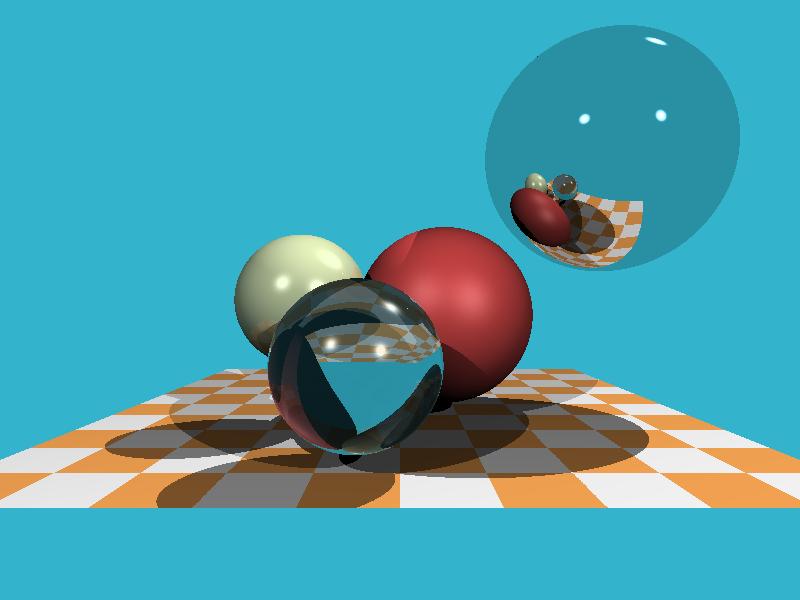

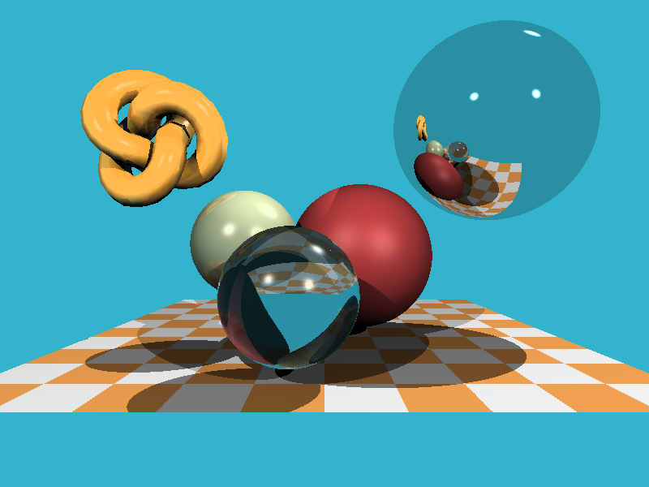

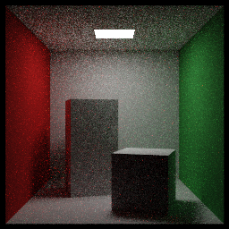

The small ray/mesh PNG discrepancies are concentrated in a few pixels; average absolute channel differences are only 0.00225 and 0.00226 on the 0-255 scale. This supports close agreement rather than bitwise equality with supplied references. BVH and brute-force default mesh images are pixel-identical. Path-tracer accuracy is measured in linear RGB against the PFM, not against the tone-mapped PNG. [Image comparison data](../../evidence/data/image-comparisons.json).

## 5. Write-up 1: tiny ray tracer

### 1.1: ray-sphere worked examples

> **Question 1.1 (handout p. 5; plain-language version)**
>
> 1. Use a sphere at `(0,0,-5)` with radius 1. Point the ray along `(0,0,-1)`.
> 2. For a ray starting at `(0,0,0)`, run `--probe`. Where does it first hit the sphere?
> 3. Use Equation 3 to work out both hit distances by hand. Find the mistake in the chapter's b = +10 calculation and its claim that there is no valid hit.
> 4. Do the same calculation for a ray starting at `(0,0,3)`. Do your answers match the probe?

**Answer and evidence**

The sphere is centred at (0, 0, -5), radius 1, and d = (0, 0, -1). Equation 3 uses oc = o - centre, so d dot oc is **negative** for a sphere in front of this camera.

| Origin    | a, b, c    | Discriminant  | Both roots                     | Measured probe |
| --------- | ---------- | ------------- | ------------------------------ | -------------- |
| (0, 0, 0) | 1, -10, 24 | 100 - 96 = 4  | (10 - 2)/2 = 4; (10 + 2)/2 = 6 | t = 4          |
| (0, 0, 3) | 1, -16, 63 | 256 - 252 = 4 | (16 - 2)/2 = 7; (16 + 2)/2 = 9 | t = 7          |

The slip in the chapter example described by the handout is b = +10: the z direction is -1, so b = 2(-1)(5) = -10. Both roots are forward, and the code selects the nearer one. Moving the origin three units backward increases both distances by three. Executed command: build/Release/raytrace.exe --probe; [actual output](../../evidence/terminal/P1-probe.txt).

### 1.2: zero EPS and scene scale

> **Question 1.2 (handout p. 5; plain-language version)**
>
> 1. Compare the normal render with `--eps 0`. What looks different?
> 2. Why can rounding make a new shadow ray hit the surface it just left? Explain how this produces dark speckles.
> 3. Read the floor test in `scene.cpp`. Why does the floor stay clean?
> 4. If every scene coordinate becomes 1000 times larger, does EPS = 0.001 still give a suitable offset? Explain using millimetres.

**Answer and evidence**

P1-default uses EPS 0.001; [P1-eps-zero](../../evidence/terminal/P1-eps-zero.txt) used --eps 0. The zero-offset image has dense dark speckling on the spheres and counts 14.027 rays/pixel rather than 8.801, because erroneous near hits also change recursive paths.

A computed point p = o + td is rounded to floats. On a sphere it can fall slightly inside the quadratic surface. A shadow ray starting exactly there then finds a tiny **positive** root on that same sphere, mistakes it for an occluder, and removes the lamp's light. Moving the origin along the outgoing side of the normal suppresses this self-intersection.

The floor in src/core/scene.cpp is the plane y = -4, with t = -(r.o.y + 4)/r.d.y and rejection at t <= EPS. For this scene the plane calculation puts the outgoing origin on y = -4, so the repeated plane hit is t = 0 and is rejected even when EPS = 0. It does not repeat the sphere's rounded quadratic calculation. This explains the visibly clean planar floor; it is not a guarantee that every floating-point plane construction is exact.

EPS has distance units. If metre-valued coordinates are all multiplied by 1000 to represent millimetres, numeric EPS 0.001 becomes 0.001 mm (one micrometre), 1000 times smaller relative to the scene. EPS 1.0 mm preserves the former 0.001 m offset. A fixed epsilon therefore depends on scene scale.

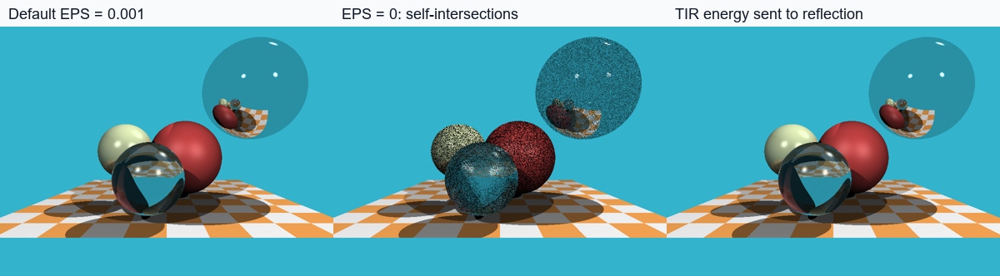

### 1.3: depth, ray counts and time

> **Question 1.3 (handout p. 6; plain-language version)**
>
> 1. Run depths 0, 1, 2, 3 and 4. Make a table of time and rays per pixel.
> 2. At a hit, count the shadow, reflection and refraction rays your code sends. Does it trace reflection or refraction even when their colour weights are zero?
> 3. Explain why your counts do not follow the chapter's 1 -> 3 -> 9 pattern. Include what happens when a ray leaves the scene.
> 4. Which unnecessary rays could you remove without changing the image? Calculate the saving.

**Answer and evidence**

Each row ran build/Release/raytrace.exe --depth D --out evidence/images/part-1/P1-depth-D.png. Panels are linked individually.

| Depth | Time (ms) | Rays / pixel | Panel                                                |
| ----- | --------- | ------------ | ---------------------------------------------------- |
| 0     | 3.4       | 2.095        | [P1-depth-0](../../evidence/terminal/P1-depth-0.txt) |
| 1     | 4.9       | 3.652        | [P1-depth-1](../../evidence/terminal/P1-depth-1.txt) |
| 2     | 5.5       | 5.173        | [P1-depth-2](../../evidence/terminal/P1-depth-2.txt) |
| 3     | 6.9       | 6.889        | [P1-depth-3](../../evidence/terminal/P1-depth-3.txt) |
| 4     | 11.6      | 8.801        | [P1-depth-4](../../evidence/terminal/P1-depth-4.txt) |

At a stage-6 hit the implementation tests **three shadow rays**, traces one reflection, and traces one refraction when Snell's law permits it. It deliberately traces the last two even for zero material weights, matching the lesson's reference behaviour. Shadow rays perform an intersection query but do not spawn recursive ray trees. Misses return background immediately. Calls at depth > MAX_DEPTH also return background **before** calling scene_intersect, so they are not counted. Depth 0 still shades camera hits and tests their shadows.

Consequently the chapter's schematic 1 -> 3 -> 9 is not this counter's recurrence. Only radiance rays branch; rays that miss stop, geometry controls later hits, and the panel includes nonbranching shadow queries. Growth need not follow a fixed factor.

The isolated [skip-zero-weights variant](../../evidence/data/variants/skip-zero-weights/changes.json) traces reflection only for a2 > 0 and refraction only for a3 > 0. It produces a **pixel-identical** image with **3.566 rays/pixel**, saving 5.235 per pixel, about **2.51 million queries / 59.5%** at 800 x 600. Its measured time was 4.8 ms versus the initial default's 9.1 ms; the ray-count saving is deterministic, while those single-run timings are approximate. Other possible savings include avoiding lights whose relevant Phong and Lambert contributions are provably zero, and stopping visibility at the light; these were not included in that measured variant. [Variant panel](../../evidence/terminal/P1-skip-zero-weights.txt).

### 1.4: glass wedge and a one-line change

> **Question 1.4 (handout p. 6; plain-language version)**
>
> 1. Find the dark wedge in the stage-6 glass sphere.
> 2. Change one line to make it disappear, then undo the change to bring it back. Show both images.
> 3. Use Equation 4 to explain the appearance and the effect of your change.
> 4. Where would the light go in real life? What does this simplified renderer do instead?

**Answer and evidence**

A reproducible one-line experiment changes the refract call's index argument from material.ior to 1.0f. The [variant and exact replacement](../../evidence/data/variants/glass-ior-one/changes.json) make the glass optically match air. Its refracted image loses the displaced dark wedge because it now sees straight through. This changes the optical model; it is a demonstration of the cause, not a physically correct glass improvement. The B1 executable restores the original image exactly in [P1-restored](../../evidence/terminal/P1-restored.txt). All variants used copied sources, so the final student files never needed restoration.

Equation 4 explains the change: eta = 1 gives k = cos(i)^2 and the transmitted direction equals d. At IOR 1.5, entry and exit bend the ray. A [diagnostic trace](../../evidence/terminal/P1-trace-wedge.txt) for pixel (300, 380) shows its transmitted path striking the red rubber sphere's shadowed side at approximately (-0.782, -1.915, -16.662), where D = S = 0. This dark view is refracted into the glass silhouette. The Whitted light queries treat intervening glass as an opaque blocker rather than following bent connections to the point lights. Real transparent transport can bring light along refracted paths and focus caustics; this implementation has no such diffuse-light transport.

It would be incorrect to call this measured wedge total internal reflection without checking. A diagnostic default render counted **zero k < 0 events** ([panel](../../evidence/terminal/P1-diagnose-tir.txt)); assigning failed-transmission weight to reflection changed **zero pixels**. When TIR occurs in another configuration, Equation 4 says no transmitted ray exists and the light reflects internally; the baseline code instead leaves the a3 term black rather than transferring that weight to reflection. The independent geometric check verifies that the function correctly reports TIR for a deliberately constructed high-angle exit ray. These are separate statements about the equation and this particular rendered scene.

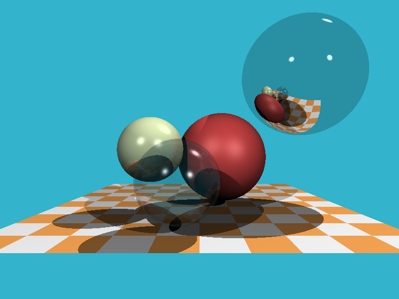

### Part I supporting stages

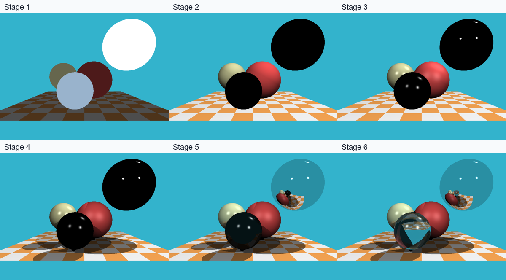

Stages 1-3 count 1.000 ray/pixel; stage 4 counts 2.095; stage 5 counts 2.957; stage 6 counts 8.801. Glass and mirror have zero diffuse weight, so they turn dark at stage 2 and become recognisable through specular and recursive contributions later.

## 6. Write-up 2: triangles

### 2.1: sweep, scaling and extrapolation

> **Question 2.1 (handout p. 8; plain-language version)**
>
> 1. The handout asks you to predict the sweep results before running it. The results here already exist, so date any later prediction honestly.
> 2. Make a table of the sweep results. Make two plots: time versus triangle count N, and triangle tests per ray versus N. Use log scales on both axes and fit the slopes.
> 3. Why does brute force average fewer than N triangle tests per ray? Calculate what fraction of rays reach the knot's bounding sphere.
> 4. Estimate the cost for 10 million triangles, using brute force and BVH if implemented. Label these as estimates, not measurements.
> 5. Discuss the chapter's claim of about 30 operations per ray for a 10-million-triangle BVH. Are your counters measuring the same kind of work?
> 6. For the 16k knot, compare your time with the chapter's 5-ms target for 10K+ triangles. Check both 320 x 240 and 800 x 600.

**Answer and evidence**

Executed build/Release/mesh.exe --sweep three times sequentially. The supplied sweep uses only primary rays, a knot alone centred at (0, 0, -10), size 7, and 320 x 240 pixels. It is a different workload from the default fully shaded scene. The table contains medians of the three recorded panels, not handout sample timings. [Raw sweeps](../../evidence/data/mesh-sweep-raw.csv), [median CSV](../../evidence/data/mesh-sweep-medians.csv), [fit calculations](../../evidence/data/fits.json).

| Actual N | Method      | Build (ms) | Render (ms)            | Triangle tests / ray | Popped nodes / ray |
| -------- | ----------- | ---------- | ---------------------- | -------------------- | ------------------ |
| 1024     | Brute force | 0.0        | 10.7                   | 322.0                | 0.0                |
| 1024     | Median BVH  | 0.3        | 1.8                    | 3.2                  | 5.4                |
| 1024     | SAH BVH     | 1.3        | 1.9                    | 2.6                  | 8.3                |
| 2048     | Brute force | 0.0        | 16.9                   | 634.2                | 0.0                |
| 2048     | Median BVH  | 0.7        | 1.5                    | 3.2                  | 6.1                |
| 2048     | SAH BVH     | 2.7        | 1.7                    | 2.5                  | 8.7                |
| 4096     | Brute force | 0.0        | 33.2                   | 1273.6               | 0.0                |
| 4096     | Median BVH  | 1.4        | 1.7                    | 2.9                  | 6.0                |
| 4096     | SAH BVH     | 5.9        | 1.9                    | 2.2                  | 8.6                |
| 16384    | Brute force | 0.0        | 109.9                  | 5056.0               | 0.0                |
| 16384    | Median BVH  | 5.8        | 1.7                    | 2.7                  | 6.6                |
| 16384    | SAH BVH     | 24.5       | 1.8                    | 1.9                  | 8.4                |
| 65536    | Brute force | -          | **Skipped by program** | -                    | -                  |
| 65536    | Median BVH  | 27.2       | 1.8                    | 2.6                  | 7.1                |
| 65536    | SAH BVH     | 102.9      | 2.6                    | 1.7                  | 8.8                |
| 262144   | Brute force | -          | **Skipped by program** | -                    | -                  |
| 262144   | Median BVH  | 117.1      | 2.5                    | 2.5                  | 7.7                |
| 262144   | SAH BVH     | 435.5      | 2.3                    | 1.7                  | 9.5                |

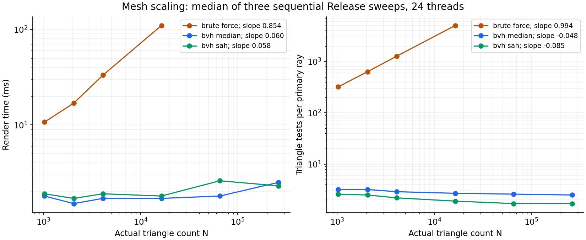

Ordinary least squares fits log(y) = intercept + slope\*log(N), using the four measured brute-force sizes and six BVH sizes:

| Method      | Time slope | Triangle-test slope |
| ----------- | ---------- | ------------------- |
| Brute force | 0.854      | 0.994               |
| Median BVH  | 0.060      | -0.048              |
| SAH BVH     | 0.058      | -0.085              |

Brute-force triangle work is almost exactly linear. Timing has fixed thread/scheduling costs as well as triangle work, so its measured exponent is below one. BVH time changes little over this range; slightly falling tests/ray are possible as finer triangles and subdivision reject more irrelevant geometry on the same visible surface. These small empirical slopes are not proofs of constant-time BVH complexity.

Each ray entering the bounding sphere causes exactly N brute-force tests here. Thus the sphere-reaching fraction is tests/ray divided by N: **322/1024 = 31.45%** at 1k and **5056/16384 = 30.86%** at 16k. The other rays skip the entire mesh. Slight variation comes from the sampled knot geometry and its bound.

**10-million-triangle extrapolations, not measurements:** the unconstrained power fit predicts **25.9 seconds** brute-force at 320 x 240. A structural linear-work extrapolation from 16k instead predicts 109.9\*(10^7/16384) = **67.1 seconds** and about **3.09 million triangle tests per primary ray** at the same sphere-reaching fraction. Their large difference shows why the small-range timing exponent is unsafe for long-range prediction; the linear-work estimate respects this algorithm's O(N) cost.

For BVH, an additive logarithmic timing fit T = a + b\*log2(N) gives median a = 0.6965 ms, SAH a = 0.8965 ms, and b = 0.08421 ms/doubling for both, predicting **2.65 / 2.85 ms** at 10^7. These are extrapolations of a fixed-view primary-ray workload; memory layout, cache behaviour, changed geometry, and rebuilding can invalidate them. No 10M-triangle mesh was built or timed.

The chapter's "about 30 operations" is not directly comparable with these counters. log2(10^7) is about 23.25 tree levels in an ideal balanced search, but traversal can visit both children, a box or triangle test requires many arithmetic instructions, and this counter records popped nodes, not every child-box test. A BVH is much cheaper than millions of triangle tests here; the evidence does not establish 30 scalar operations per ray.

For the 5-ms claim, the 800 x 600 experiment used the **same primary-ray scene** through a separate [evidence harness](../../evidence/tools/primary_800.cpp) linked to B1, leaving framework files unchanged. [Actual 800 x 600 panel](../../evidence/terminal/P2-primary-800.txt); three render repeats, medians below.

| 16384 triangles, primary rays | Brute force             | Median BVH      | SAH BVH         |
| ----------------------------- | ----------------------- | --------------- | --------------- |
| 320 x 240, measured median    | 109.9 ms (21.98 x 5 ms) | 1.7 ms (0.34 x) | 1.8 ms (0.36 x) |
| 800 x 600, measured median    | 653.1 ms (130.62 x)     | 4.4 ms (0.88 x) | 6.1 ms (1.22 x) |

Median BVH meets 5 ms for these timed primary queries at both resolutions; SAH meets it only at 320 x 240. Build cost is excluded and is already above 5 ms for the 16k median tree. A full 800 x 600 Whitted render with --tris 16k --bvh took **91.0 ms** plus 23.7 ms building the SAH tree ([panel](../../evidence/terminal/P2-16k-full-bvh.txt)). Under-5-ms primary tracing therefore does not imply an under-5-ms fully shaded frame.

**Comparison with the later prediction exercise.** The nearly linear triangle-test slope supports the student's brute-force intuition. BVH growth is much slower over this fixed-view sweep; median/SAH timing depends on the build/traversal tradeoff.

### 2.2: flat versus interpolated normals

> **Question 2.2 (handout p. 8; plain-language version)**
>
> 1. Compare the default image with `--flat`. Why does the shading change even though the triangles stay in the same places?
> 2. Use Equation 6 to explain why the hit calculation already gives u and v: weights locating the hit inside a triangle.
> 3. What else, besides normals, could you blend between the three vertices using those weights?

**Answer and evidence**

The default and --flat keep the same triangle positions, so the silhouette is unchanged. The flat version shows distinct polygonal highlight bands; smooth barycentric normals make the tube appear rounded. Rays/pixel differ slightly (10.917 vs 10.840), because changed normals also change secondary-ray directions. [Flat panel](../../evidence/terminal/P2-flat.txt).

Equation 6 solves u and v while deciding whether the triangle is hit; no second intersection is needed to obtain them. Interpolating (1-u-v)*n0 + u*n1 + v\*n2, followed by normalization, therefore reuses coordinates already available. "Free" refers to those coordinates; attribute interpolation itself still takes arithmetic. The same weights can interpolate UV texture coordinates, vertex colours, tangents, and suitable scalar material attributes.

### 2.3: back-face culling

> **Question 2.3 (handout p. 8; plain-language version)**
>
> 1. Change `abs(a) < 1e-8` to `a < 1e-8`. This removes hits on triangle backs.
> 2. Compare the default knot before and after the change. What changes, and why? Do its triangle fronts point inward or outward?
> 3. Repeat with `--glass`. Why does skipping the back faces affect glass differently?
> 4. When could a GPU safely skip glass back faces? When must it keep them?

**Answer and evidence**

The isolated one-line change is fabs(determinant) < 1e-8f -> determinant < 1e-8f. [Exact variant](../../evidence/data/variants/cull-backfaces/changes.json). The student implementation retains the two-sided test.

| Material | Setting         | Time (ms), rays/pixel | Image / panel                                                   |
| -------- | --------------- | --------------------- | --------------------------------------------------------------- |
| Gold     | Two-sided       | 404.5, 10.917         | [Default panel](../../evidence/terminal/P2-default.txt)         |
| Gold     | Cull back faces | 110.5, 9.546          | [Culled panel](../../evidence/terminal/P2-cull-default.txt)     |
| Glass    | Two-sided       | 358.1, 10.744         | [Glass panel](../../evidence/terminal/P2-glass.txt)             |
| Glass    | Cull back faces | 131.6, 9.560          | [Culled glass panel](../../evidence/terminal/P2-cull-glass.txt) |

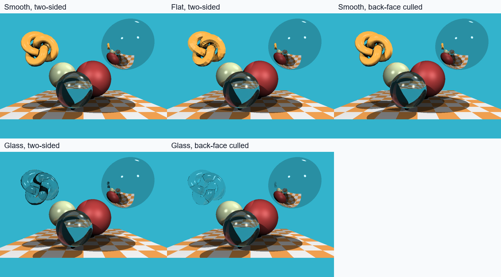

The gold knot looks almost unchanged: its outer front surfaces remain. There are small secondary/visibility differences: 0.236% of the complete image's pixels change. The glass knot changes substantially (4.815% of full-image pixels), losing internal structure and appearing more transparent, because transmitted rays inside the tube need its back-facing exit intersections. Culling skips those interfaces and omits the associated refraction/reflection.

The generator's faces point outward. The verification harness measured a mean dot product **+0.915272** between geometric face normals and the generator's outward vertex normals; curved triangles need not align exactly. Rays entering the tube see front faces; rays leaving it see back faces. A GPU may cull the backs for an opaque exterior-only pass, or separate front/back passes with explicit thickness/exit handling. A general thick-glass renderer must retain the needed exits; ordinary back-face removal is not a valid substitute for transmission.

### 2.4: optional BVH comparison

> **Question 2.4 (handout p. 8; plain-language version)**
>
> 1. Optional: answer this if you implemented BVH traversal.
> 2. Compare median and SAH splitting. Record build time, visited nodes per ray, triangle tests per ray and render time.
> 3. Why might SAH visit more boxes but test fewer triangles? Use Equation 10.05 and the cost constants in `bvh.cpp`.
> 4. Which is faster on your machine, and by how much? Discuss building the tree and rendering with it separately.

**Answer and evidence**

Attempted and verified. The supplied builder uses CT = 1.0, CI = 1.5, 16 SAH bins, and a leaf threshold of four triangles, with a maximum depth of 60. Median splits balance triangle counts along the longest centroid extent. SAH chooses spatial divisions minimizing CT + SA(L)/SA(P)*NL*CI + SA(R)/SA(P)*NR*CI. Its cost model values triangle tests more than traversal, but these constants are estimates rather than this machine's measured timings.

At 16k, SAH reduces tests/ray from **2.7 to 1.9** (about 30%) while increasing popped nodes/ray from **6.6 to 8.4** (about 27%). Its build takes **24.5 vs 5.8 ms**, and its 320 x 240 render takes **1.8 vs 1.7 ms**. Median is marginally faster there; the 0.1-ms difference is small relative to observed timing variation. At 262k, SAH renders in **2.3 vs 2.5 ms**, about 8% less time, but builds in **435.5 vs 117.1 ms**. At 800 x 600 and 16k, median's **4.4 vs 6.1 ms** is about 28% less render time. The winner depends on workload, reuse of a built tree, and the actual cost of box traversal versus triangle intersection. Node counts here count popped nodes once; child-box ordering tests are extra work and help explain why fewer triangle tests need not mean less total time.

## 7. Write-up 3: path tracer

### 3.1: convergence, seeds and reference noise

> **Question 3.1 (handout p. 13-14; plain-language version)**
>
> 1. The handout asks for predictions before these runs. Keep any later prediction honestly dated.
> 2. Run `--sweep`. Include the table and a log-log plot of RMSE (error) versus spp (samples per pixel). Is the fitted slope near -0.5?
> 3. At 256 spp, does `RMSE * sqrt(spp)` rise? Explain how noise in the reference image could cause this.
> 4. Run `--sweep --seed 1` to use different random samples. Does the same pattern appear?
> 5. Estimate the samples and runtime needed for ten times less noise than at 16 spp. Compare with the chapter's rule: four times the samples gives half the noise.

**Answer and evidence**

Executed build/Release/pathtrace.exe --sweep --seed 0 and the same command with seed 1. NEE and RR are enabled, depth 64, 24 threads. [Seed-0 panel](../../evidence/terminal/P3-sweep-seed-0.txt), [seed-1 panel](../../evidence/terminal/P3-sweep-seed-1.txt), [data CSV](../../evidence/data/path-sweeps.csv).

| Seed | spp | Time (ms) | Masked RMSE | RMSE \* sqrt(spp) |
| ---- | --- | --------- | ----------- | ----------------- |
| 0    | 1   | 8.6       | 0.0805      | 0.0805            |
| 0    | 4   | 26.3      | 0.0407      | 0.0814            |
| 0    | 16  | 95.8      | 0.0206      | 0.0824            |
| 0    | 64  | 363.4     | 0.0104      | 0.0831            |
| 0    | 256 | 1483.7    | 0.0054      | 0.0868            |
| 1    | 1   | 9.0       | 0.0809      | 0.0809            |
| 1    | 4   | 26.1      | 0.0406      | 0.0813            |
| 1    | 16  | 100.0     | 0.0204      | 0.0817            |
| 1    | 64  | 394.4     | 0.0102      | 0.0814            |
| 1    | 256 | 1521.7    | 0.0050      | 0.0793            |

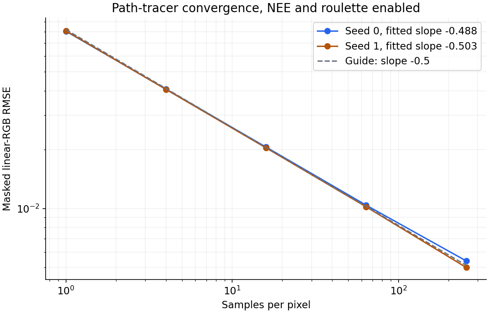

The executable fits ordinary least squares on **unrounded** log(RMSE) versus log(spp), using all five points. Its slopes are **-0.488** for seed 0 and **-0.503** for seed 1, close to Equation 9's -1/2. The plot uses the rounded panel points; the retained slope comes from the renderer's unrounded fit.

The PFM is a finite **4096-spp estimate**, not exact ground truth. For independent equal-variance image/reference estimates, squared comparison error is approximately C*(1/spp + 1/4096), so RMSE*sqrt(spp) grows like sqrt(C*(1+spp/4096)). Seed 0's scaled error rises at 256, but seed 1's falls to 0.0793. Finite-sample fluctuations and covariance matter: shared sample streams can reduce comparison error, yielding C*(1/spp - 1/4096) in the nested-sample ideal. Seed 1's behaviour is consistent with that kind of correlation; the reference generation script/seed was not supplied, so its exact seed is not asserted.

For **ten times less sampling noise than at 16 spp**, Equation 9 gives 16*10^2 = **1600 spp**, not 160. Linear runtime extrapolation from the seed-0 256-spp timing gives 1483.7*(1600/256) = **9273 ms, about 9.3 seconds**; this is an estimate, not a timed 1600-spp run. Four times the samples halves noise, consistent with both the chapter's claim and the measured ratios. If the target is literally ten times smaller RMSE **against this noisy reference**, the independent-error model needs roughly **2609 spp**, because reference variance does not vanish. That secondary estimate assumes independent, equal-variance samples and is not a measured requirement.

**Comparison with the later prediction exercise.** The falling noise and approximately linear runtime match the student's qualitative expectation. The fitted slopes support inverse-square-root decay, rather than logarithmic decay.

### 3.2: next event estimation

> **Question 3.2 (handout p. 14; plain-language version)**
>
> 1. The handout asks for a prediction before this experiment. Keep the existing deferred-prediction record honest.
> 2. At 16 spp, compare the default with `--no-nee` (no explicit lamp sampling). Show the images and compare error and time.
> 3. How many no-NEE samples give roughly the same error as default NEE at 16 spp? Show which sample counts you tested.
> 4. Why does sampling the lamp directly help? Estimate how often a cosine-weighted random bounce from the middle of the floor would reach the lamp.

**Answer and evidence**

| Configuration                  | spp  | Seed | Masked RMSE | Time (ms) | Panel                                                        |
| ------------------------------ | ---- | ---- | ----------- | --------- | ------------------------------------------------------------ |
| NEE on, default                | 16   | 0    | 0.0206      | 92.2      | [P3-default](../../evidence/terminal/P3-default.txt)         |
| NEE off                        | 16   | 0    | 0.2168      | 70.0      | [P3-no-nee-16](../../evidence/terminal/P3-no-nee-16.txt)     |
| NEE off                        | 256  | 0    | 0.0540      | 989.3     | [P3-no-nee-256](../../evidence/terminal/P3-no-nee-256.txt)   |
| NEE off                        | 1024 | 0    | 0.0268      | 4290.7    | [P3-no-nee-1024](../../evidence/terminal/P3-no-nee-1024.txt) |
| NEE off                        | 1664 | 0    | 0.0211      | 7361.2    | [P3-no-nee-1664](../../evidence/terminal/P3-no-nee-1664.txt) |
| NEE off, matches tested target | 1792 | 0    | 0.0204      | 6506.7    | [P3-no-nee-1792](../../evidence/terminal/P3-no-nee-1792.txt) |

The matching criterion is RMSE <= the default 16-spp RMSE 0.0206 at the same resolution/seed/depth. **1792 spp is the lowest tested count that meets it**, not a claim to have found the exact minimum. The tested bracket is 1664-1792; errors are not guaranteed strictly monotonic for every count. The variance estimate 16\*(0.2168/0.0206)^2 = **1772 spp** agrees with that bracket. The matched run uses 112 times as many samples and about 71 times the initial default's runtime. The 1664-spp run taking longer than 1792 illustrates timing variation rather than a different work-scaling law.

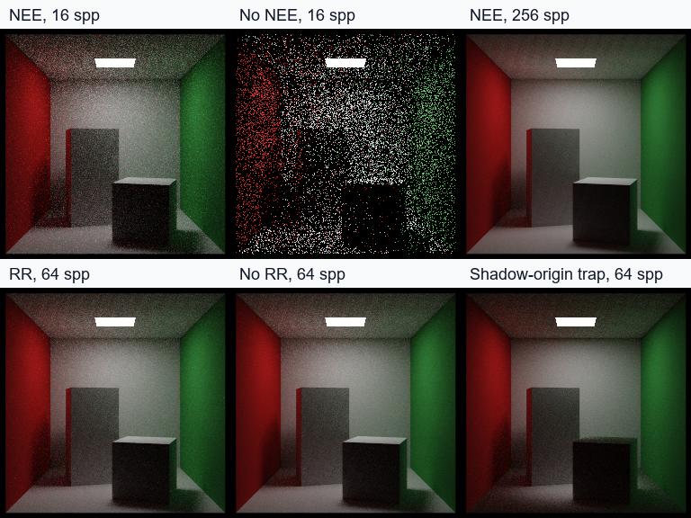

Without NEE, most samples never find the lamp and return zero, while a few bright samples carry large weight; at 16 spp the image is sparse and speckled. NEE spends an explicit sample on the lamp at every diffuse hit, trading a visibility query for much lower variance. The mean still agrees approximately (no-NEE at 16 spp: 0.1589), while its RMSE is over ten times larger.

The lamp area is 130*105 = **13650 square scene units**. From the floor midpoint (278, 0, 278), its centre is (278, 554, 279.5). Treating the lamp as a small patch, its cosine-sampled directional probability is approximately A*cos(theta_floor)*cos(theta_lamp)/(pi*d^2) = **0.01416, about 1.4%**, before occlusion. An additional deterministic 200,000-direction experiment measured **1.445%** geometrically within the rectangle and **1.0935%** reaching it before other scene geometry ([output](../../evidence/terminal/P3-lamp-fraction.txt), [source](../../evidence/tools/lamp_fraction.cpp)). That is roughly one visible-lamp direction per 91 floor samples. It explains why targeting the lamp helps; it is not an exact prediction of whole-image variance, which includes other surfaces and indirect paths.

**Comparison with the later prediction exercise.** The student's expectation of more speckles without NEE is supported. Lower cost per sample did not compensate for the much larger matching sample count in this experiment.

### 3.3: Russian roulette and the chapter code

> **Question 3.3 (handout p. 14; plain-language version)**
>
> 1. At 64 spp, compare the default with `--no-rr` (no Russian roulette). Record average brightness, error, time and rays per sample.
> 2. Does roulette keep the expected brightness correct? Is the extra noise worth the saved time? Compare `1 / (RMSE^2 * time)` with consistent time units.
> 3. The handout refers to a chapter example called "Lab 10, Part 1: CPU Path Tracer". If available, check what is missing from its `Hit` type for it to compile.
> 4. Could its line `return hit.emissive ? vec3(12.f) : vec3(0)` actually return 12 after roulette, or would the path stop first?
> 5. The chapter chooses the stopping chance q from the current surface's reflectance, instead of the total path weight, and starts roulette at the first bounce. Which choices could make the result wrong? Which only affect noise or speed?
> 6. Test at least one choice by changing your code and measuring the result. Where the chapter code is missing, compare with this lab's Part III and say what you cannot directly check.

**Answer and evidence**

At 64 spp, depth 64, seed 0, NEE on:

| Configuration                    | Mean   | RMSE   | Time (ms) | Rays / sample | Efficiency, 1/(RMSE^2 \* seconds) |
| -------------------------------- | ------ | ------ | --------- | ------------- | --------------------------------- |
| B1 RR after first three surfaces | 0.1584 | 0.0104 | 373.1     | 5.04          | 24780                             |
| No RR                            | 0.1584 | 0.0083 | 928.9     | 10.61         | 15627                             |
| Variant: RR from first surface   | 0.1585 | 0.0146 | 189.4     | 3.08          | 24769                             |

[Default 64-spp panel](../../evidence/terminal/P3-spp-64.txt), [no-RR panel](../../evidence/terminal/P3-no-rr-64.txt), [first-bounce variant panel](../../evidence/terminal/P3-rr-first-bounce.txt).

The compensated roulette decision is unbiased: survival with probability 1-q followed by division by 1-q preserves expected future throughput (Equation 13). Means agreeing to four decimals support consistency but do not prove unbiasedness from one seed. The finite maximum depth is still a separate truncation. Compared with no RR, B1 uses about 52.5% fewer queries per sample and 59.8% less measured time, but has about 25% higher RMSE. Its measured error-time efficiency is about **1.59 times** as high. Both efficiencies use seconds consistently and the panel's rounded RMSE.

The measured code change is "if(bounce < 3)" -> "if(bounce < 0)" in [an isolated copy](../../evidence/data/variants/rr-first-bounce/changes.json), keeping the same accumulated-throughput probability, clamping, and survivor correction. Starting earlier increases RMSE from 0.0104 to 0.0146 and lowers time to 189.4 ms; these runs have almost equal efficiency. The 0.04% efficiency difference is far too small to establish a winner from single timings. Earlier roulette is not inherently biased, but it can trade more variance for fewer rays. The final source retains the handout's bounce-3 rule.

**What can be answered about the "Lab 10, Part 1" reference:** the assignment is Lab 09, but page 14 of its handout explicitly refers to a separately printed chapter listing. Only the excerpt/description was supplied. The following comparison uses this repository's Part III where possible, rather than inventing that listing:

- A statement using hit.emissive requires an emissive member or an equivalent emission lookup. This repository's Hit has no such member. Its working design instead uses hit.tri and pt_material(scene, hit).emission; the lamp emission here is **15**, not the excerpt's 12. No header edit is necessary for this lab's implementation.
- The quoted "return hit.emissive ? vec3(12.f) : vec3(0)" can return 12 only if control survives every earlier roulette return. If q is taken from an emissive hit's zero diffuse albedo without clamping, q = 1 and the lamp is always killed first, so it cannot return 12. If q is clamped below one, it can survive; then an unweighted literal emissive return after roulette must still account for survival probability to avoid bias. The excerpt does not expose all surrounding code, so its exact reachability cannot be confirmed unconditionally.
- B1 checks terminal emission **before** roulette and adds throughput \* emission for allowed lamp-front hits. The independent test confirms that a camera ray into the lamp front returns luminance 15 and into the back returns zero. This verifies the available Part III code directly.
- Choosing q from current albedo instead of accumulated throughput does not by itself bias an estimator when the rule is valid and survivors are compensated. It changes which paths are retained and their variance/cost; accumulated throughput also accounts for earlier attenuation and colour. Starting roulette at the first bounce is likewise a variance/runtime choice. Killing emission before recording it, allowing certain termination where future contribution is nonzero, or failing to compensate survivors affects correctness.

The exact chapter Hit definition, its q clamp, and all surrounding return logic remain **unavailable for direct reference**. These are conditional conclusions about the described excerpt, not a claim to have compiled or inspected that missing chapter. This repository's Part III and the measured early-roulette experiment provide the available comparison.

### 3.4: depth and missing light

> **Question 3.4 (handout p. 14; plain-language version)**
>
> 1. At 64 spp, try depths 1, 2, 3, 5 and 10. Compare each image's average brightness with the reference.
> 2. How much extra light do additional bounces contribute?
> 3. How much light does a depth-10 cutoff lose? Compare with the chapter's `if(depth > 10)`, taking care about how each version counts depth.
> 4. With roulette at depth 64, most paths still stop early. Why can the surviving paths preserve the expected light from later bounces?

**Answer and evidence**

All rows use 64 spp, seed 0, NEE and RR enabled. Values below are the program's four-decimal means. The reference mean is 0.1584.

| Depth | Mean   | Reference - mean            | Added mean since preceding measured depth | Approx. relative deficit   |
| ----- | ------ | --------------------------- | ----------------------------------------- | -------------------------- |
| 1     | 0.1236 | 0.0348                      | Direct-light baseline                     | 21.97%                     |
| 2     | 0.1414 | 0.0170                      | +0.0178, surface 2                        | 10.73%                     |
| 3     | 0.1501 | 0.0083                      | +0.0087, surface 3                        | 5.24%                      |
| 5     | 0.1562 | 0.0022                      | +0.0061, surfaces 4-5 together            | 1.39%                      |
| 10    | 0.1583 | 0.0001                      | +0.0021, surfaces 6-10 together           | 0.063%                     |
| 64    | 0.1584 | 0.0000 at printed precision | +0.0001, remaining tail                   | 0.00% at printed precision |

Panels: [depth 1](../../evidence/terminal/P3-depth-1.txt), [2](../../evidence/terminal/P3-depth-2.txt), [3](../../evidence/terminal/P3-depth-3.txt), [5](../../evidence/terminal/P3-depth-5.txt), [10](../../evidence/terminal/P3-depth-10.txt), [64](../../evidence/terminal/P3-spp-64.txt). Increments between depths 3 and 5 or 5 and 10 are grouped contributions, not a separately measured value for every intervening bounce.

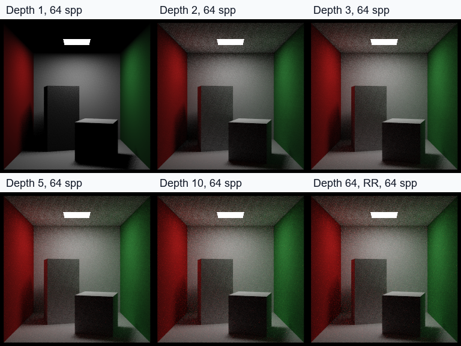

Depth 1 includes camera-visible emission and direct NEE at the first diffuse hit. The ceiling faces away from the lamp, so it needs indirect light; shadows and back-facing regions brighten with additional surfaces. Multiple diffuse bounces add progressively smaller contributions because reflectance and escape reduce expected throughput.

A depth-10 cut loses roughly **0.0001 mean luminance, about 0.06%** relative to the reference or depth-64 panel here. That is only a coarse estimate: means are rounded to 0.0001 and both estimates contain sampling error. The chapter's "if(depth > 10)" is also potentially one surface different from this executable's "bounce < max_depth": a recursion starting at zero allows depths 0-10, whereas --depth 10 allows bounces 0-9. An extra [depth-11 run](../../evidence/terminal/P3-depth-11.txt) also reports mean 0.1583; the missing full listing prevents asserting its starting convention.

Roulette does not simply discard every late contribution. Most paths stop early, but rare survivors have larger weights, preserving the average of the tail. The depth-64 safety cap is still finite, so the implementation is not literally an infinite-depth estimator; the long-depth result is consistent with negligible remaining truncation at the measured precision.

### 3.5: reintroducing the TASK 3b shadow-origin trap

> **Question 3.5 (handout p. 14; plain-language version)**
>
> 1. Choose one of the bugs described in TASK 3b or 3d. Put it back into a separate experiment version.
> 2. Run the correct and buggy versions with the same settings. Show both images and compare their average brightness.
> 3. Use Equation 12 to explain what the bug changes in the lighting calculation and why the average brightness changes.

**Answer and evidence**

The experiment chose the offset-origin mismatch because it tests visibility directly. The single copied-source change was "to_light = point - origin" -> "to_light = point - hit.p", while keeping the shadow ray's origin at hit.p + EPS\*n. [Exact change](../../evidence/data/variants/shadow-origin-trap/changes.json).

| Variant, 64 spp / seed 0 / depth 64 | Mean   | RMSE   | Time (ms) | Evidence                                                        |
| ----------------------------------- | ------ | ------ | --------- | --------------------------------------------------------------- |
| Correct offset-origin segment       | 0.1584 | 0.0104 | 373.1     | [P3-spp-64](../../evidence/terminal/P3-spp-64.txt)              |
| Mismatched direction/distance       | 0.1387 | 0.0336 | 367.4     | [Trap panel](../../evidence/terminal/P3-shadow-origin-trap.txt) |

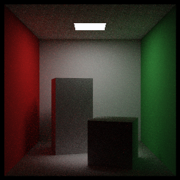

The mean falls by **0.0197, about 12.4%**. Equation 12 includes visibility V. Aiming from x while starting from x + EPS\*n means the measured endpoint is no longer the lamp sample reached by the actual segment. For a floor-to-lamp ray, the offset makes the ray reach the lamp plane early; at an oblique angle this can be more than EPS before the recorded distance. The lamp can then be found below the erroneous d-EPS limit and counted as its own blocker, changing V from one to zero. This systematic loss does not average away with more samples. The final code uses the offset origin consistently for direction, distance, and visibility; the variant was compiled separately, so no faulty edit remains to restore.

## 8. Evidence and source notes

The [evidence index](../../evidence/README.md) and [run manifest](../../evidence/data/runs.jsonl) retain exact commands, timestamps, panels, image hashes and isolated experimental source changes. Images labelled as renders were generated by the programs; supplied comparison images and the 4096-spp PFM remain under reference/. Figures made from multiple renders are comparison panels, not terminal screenshots. Numerical plots use the recorded CSV data.

Sources are the supplied Lab 09 handout (30 October 2026), the provided core/framework code, the supplied reference assets and the recorded experiments. References to numbered equations use the handout unless explicitly described as chapter equations. The full chapter's Lab 10 listing was not supplied; write-up 3.3 states which conclusions are conditional.

The [consolidated AI prompt log](../ai/ai-log.md) records every prompt available in this session. Exact model labels and student-supplied prompt reasoning/verification were not recorded where indicated; assistant checks are distinguished from student verification. No Antigravity transcript was supplied.
